# Houston renderer style guide

Visual rules for the renderer in `apps/web`. Token values live in
`apps/web/src/index.css`; this page documents the roles and the rules for using them.

## Overview & identity

Houston is a desktop shell for coding agents on Linux and Windows. Its chrome frames the
work and stays quiet: neutral surfaces, one brand accent, and status colour used only for
status. The panes are the product.

- **Two appearance modes.** `paper` is the light palette and `graphite` is the dark one.
  `useTheme` writes `.dark` on `<html>` and the chosen theme id to `data-theme-id`; a
  "System" preference resolves to one of the two before either is applied. Named themes
  (T3 Chat, Grove, Ocean, Ember, Iris) and user-defined themes override the role variables
  under `html[data-theme-id]`.
- **Neutral grounds in a small ladder.** The rail is one tonal step off the content canvas,
  cards lift above it, and the terminal is the darkest surface. The main work area runs flush to
  the chrome and the rail's own 1px divider is the only seam. Borders and dividers separate the
  levels; elevation is a ladder, not a stack of cards.
- **One accent.** The indigo from the app mark (`--accent`) is the brand fill; `--accent-ink`
  is the readable version for text, icons and focus. Selection, running state, focus, primary
  actions and the 8% wash on a user turn are where the brand hue appears.
- **The shell is square.** Grid panes have no radius and no card border. One 1px
  `--divider` separates the sidebar, top bar, grid cells and right panel. A grid of two or
  more threads carries a floating pane label instead of a pane header.
- **Controls come from primitives.** `apps/web/src/components/ui/` owns the visual recipes;
  feature code composes them with layout utilities.

When in doubt: use a neutral surface and a border before a colour, a token before a value,
and an existing primitive before a one-off class.

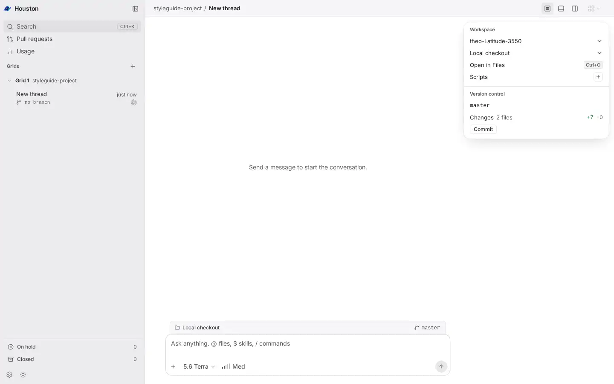
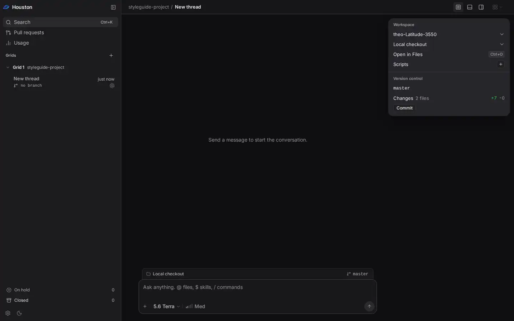

## Source of truth

| Concern                                                     | Canonical location                                                                                                |
| ----------------------------------------------------------- | ----------------------------------------------------------------------------------------------------------------- |
| Colour, radius, type, motion, control metrics and utilities | `apps/web/src/index.css`                                                                                          |
| Tailwind bindings (`@theme`, `@theme inline`, `@utility`)   | `apps/web/src/index.css`                                                                                          |
| Appearance resolution, theme ids and custom themes          | `apps/web/src/hooks/useTheme.ts`, `apps/web/src/themePalette.ts`                                                  |
| Primitives and their variants                               | `apps/web/src/components/ui/*.tsx`                                                                                |
| Shell, sidebar, grid and thread layout                      | `apps/web/src/components/AppSidebarLayout.tsx`, `grid/GridSidebar.tsx`, `grid/GridThreadCell.tsx`, `ChatView.tsx` |
| Terminal colours and ANSI palette                           | `apps/web/src/components/ThreadTerminalDrawer.tsx`, `packages/shared/src/terminalOutput.ts`                       |
| Style rules and pinned violations                           | `scripts/check-web-style.mjs`, `scripts/web-style-baseline/`                                                      |
| Approved design boards (interim)                            | `handoff/design/README.md`                                                                                        |

`handoff/` is removed before `v2` merges, so the durable v2 conventions are the ones on this
page and the rules in `scripts/check-web-style.mjs`.

## Color roles

Tokens come in surface/foreground pairs. Use the role, not the value.

### Grounds

| Token         | Role                                                    |
| ------------- | ------------------------------------------------------- |
| `--rail`      | The sidebar and app chrome. One step off the canvas.    |
| `--content`   | The main canvas. Also exposed as `--background`.        |
| `--card`      | Cards and panels lifted off the canvas.                 |
| `--raised`    | The floating tier: menus, popovers, dialogs.            |
| `--pane`      | A thread or grid cell surface.                          |
| `--pane-head` | The grid label and pane header fill.                    |
| `--composer`  | The composer and its attached banners.                  |
| `--term`      | The terminal surface. Also `--terminal-background`.     |
| `--code-bg`   | Code blocks and diff bodies. Also `--code-background`.  |
| `--field`     | Inputs, selects and other filled controls.              |
| `--hover`     | The neutral hover overlay. Exposed as `bg-hover`.       |
| `--sel`       | The neutral selected overlay. Exposed as `bg-selected`. |

The semantic aliases used by copied feature components resolve to those values:
`--background` → `--content`, `--app-chrome-background` → `--rail`, `--popover` → `--raised`,
`--sidebar` → `--rail`, and `--foreground` → `--t1`.

### Text

| Token       | Use it for                                                                |
| ----------- | ------------------------------------------------------------------------- |
| `--t1`      | Titles, active rows, values the user is reading. Also `--foreground`.     |
| `--t2`      | Supporting text and secondary labels.                                     |
| `--houston` | Muted chrome, placeholders, inactive metadata. Also `--muted-foreground`. |

Three readable tiers. Icons use `--icon-muted` (an alias of `--muted-foreground`) when they
should sit quieter than their label.

### Borders and dividers

| Token            | Use it for                                                                                                                                                |
| ---------------- | --------------------------------------------------------------------------------------------------------------------------------------------------------- |
| `--border`       | Ordinary hairlines: inputs, cards, control edges.                                                                                                         |
| `--divider`      | One-pixel seams between shell surfaces: sidebar, top bar, grid cells, right panel.                                                                        |
| `--card-edge`    | Edges of raised content cards (settings groups, changed files, plans); one step firmer than `--border` in light. Use it through `--contrast-card-border`. |
| `--border-hover` | The hover state of an ordinary hairline.                                                                                                                  |
| `--line-strong`  | The interactive edge of a field or a selected control.                                                                                                    |

### Accent

| Token              | Use it for                                                       |
| ------------------ | ---------------------------------------------------------------- |
| `--accent`         | The solid brand fill: primary actions, focus and running state.  |
| `--accent-hover`   | The hover fill for a brand action.                               |
| `--accent-ink`     | Brand text and icons: links, the running glyph, focus rings.     |
| `--accent-muted`   | A faint brand wash.                                              |
| `--accent-surface` | The color behind hover text; it is `--hover`, not a brand plate. |

`--primary` aliases `--accent`, and `bg-primary` / `text-primary-foreground` are the
primitive fill pair. Brand text uses `text-(--accent-ink)`. `text-primary` is a fill role and
fails contrast, so the guard rejects it as text.

### Status

| Token                      | Meaning                         |
| -------------------------- | ------------------------------- |
| `--ok`, `--ok-ink`         | Succeeded, ready, verified.     |
| `--warn`, `--warn-ink`     | Needs attention or input.       |
| `--stop`, `--stop-ink`     | Failed, blocked, destructive.   |
| `--info`, `--info-ink`     | Settled or neutral information. |
| `--merged`, `--merged-ink` | A merged pull request.          |

`--danger-fill`, `--danger-wash`, `--warn-wash`, `--warn-line`, `--add-bg` and `--del-bg` are
the fill and wash variants. Text uses the `-ink` token; fills use the base token.

### Known drift

The design boards call the brand colour "accent". In the code, `bg-accent` and
`text-accent-foreground` do not exist: the neutral hover fill is `bg-hover`, and the brand
fill is `bg-primary` or `bg-(--accent)`. `--accent-foreground` is `--t1`, the ink over the
neutral hover surface, not white text for a brand plate.

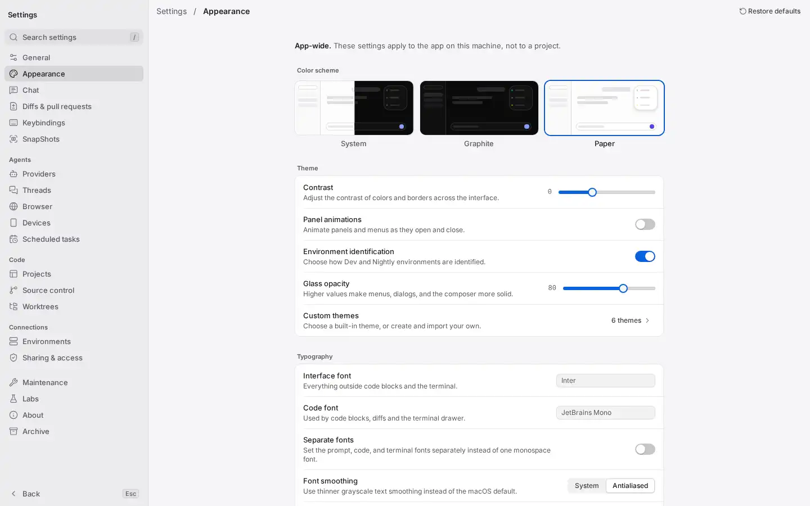
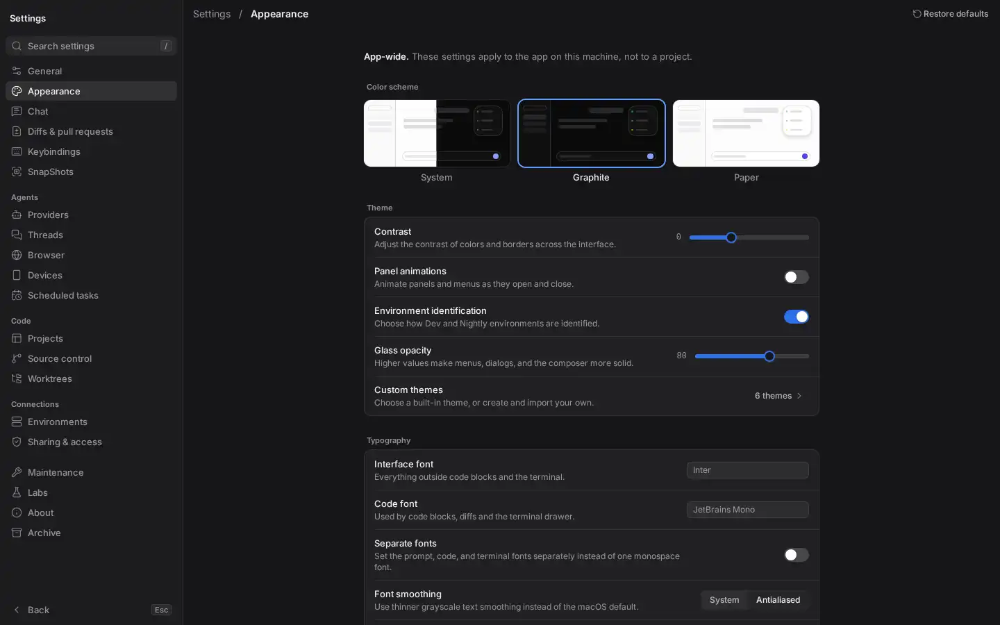

## Typography

| Family         | Token          | Use                                                                                                 |
| -------------- | -------------- | --------------------------------------------------------------------------------------------------- |
| Inter Variable | `--font-sans`  | All interface and body text. Bundled through `@fontsource-variable/inter`.                          |
| JetBrains Mono | `--font-mono`  | Paths, IDs, branches, code, terminal-adjacent values. System fallback when the face is absent.      |
| Source Serif 4 | `--font-serif` | The first-run recovery title only. System serif fallback. Welcome and empty-state titles use Inter. |

Body text is 13px / 18px, set on `<body>`. Hierarchy comes from weight and ink before size.

| Step               | Size / leading | Use                                                  |
| ------------------ | -------------- | ---------------------------------------------------- |
| `text-display`     | 34 / 40        | Window-level display moments.                        |
| `text-stat`        | 22 / 28        | Large figures in usage and summary surfaces.         |
| `text-large-title` | 26 / 32        | Destination page titles.                             |
| `text-title`       | 20 / 26        | Dialog and section titles.                           |
| `text-headline`    | 13 / 18        | Headings at body size.                               |
| `text-heading`     | 15 / 20        | Emphasised headings above body size.                 |
| `text-body`        | 13 / 18        | Default body, controls and rows.                     |
| `text-prose`       | 14 / 20        | Long-form reading: chat markdown, pull-request text. |
| `text-callout`     | 12 / 16        | Secondary lines and compact captions.                |
| `text-caption`     | 11 / 14        | Dense labels and metadata.                           |
| `text-mono`        | 12 / 18        | Code-adjacent labels inside the timeline.            |

`text-2xs` (11/14), `text-3xs` (10/14), `text-4xs` (8/8) and `text-5xs` (7/7) are the dense
steps for counts, keyboard hints and provider-icon overlays. Interface copy does not go below
11px; the smaller steps are for badges and icon overlays.

## Spacing & control metrics

Spacing uses Tailwind's 0.25rem scale (`p-*`, `gap-*`, `m-*`) and arbitrary lengths are
rejected by the `spacing` rule. There is no `--space-*` token set.

| Token                | Value | What it measures                                    |
| -------------------- | ----- | --------------------------------------------------- |
| `--h-top`            | 40px  | The app top bar (`--workspace-topbar-height`).      |
| `--h-pane-head`      | 30px  | A pane header and the diff panel's toolbar.         |
| `--h-ctl`            | 28px  | Buttons, selects and toggles at their default size. |
| `--h-row`            | 28px  | Sidebar and rail rows.                              |
| `--h-pill`           | 26px  | Selection and floating-label pills.                 |
| `--w-window-control` | 30px  | One window-control button.                          |
| `--settings-w`       | 720px | The Settings content column.                        |

Primitive heights are part of their recipe:

| Primitive  | Heights                                                                                                  |
| ---------- | -------------------------------------------------------------------------------------------------------- |
| `Button`   | 28px default/compact, 26px `selection`, 24px `xs`, 22px `sm`, 20px `micro`; icon sizes 28/28/22/20/16px. |
| `Input`    | 26px default, 22px `compact`, 30px `lg`.                                                                 |
| `Textarea` | 70px minimum by default; `sm` and `lg` adjust the minimum and padding.                                   |
| `Select`   | 28px `default`/`compact`, 24px `sm`/`xs`.                                                                |
| `Badge`    | 24px `control`, 20px `default`, 16px `sm`.                                                               |
| `Kbd`      | 18px.                                                                                                    |
| `Switch`   | 20px, or 18px in `sm`.                                                                                   |
| `Checkbox` | 18px, or 16px below the `sm` breakpoint.                                                                 |

`pointer-coarse` adds a 44px hit area to buttons and badges on touch devices. A smaller
visible box is acceptable only when the hit target reaches the same floor.

**Known drift.** `--h-ctl` is 28px, but the `Input` primitive is 26px by default and the
grid label is a 26px pill (`--h-pill`). Treat the table above as the per-primitive contract,
not as a single universal control height.

## Radius

| Token           | Value | Meaning                                                     |
| --------------- | ----- | ----------------------------------------------------------- |
| `--r-badge`     | 4px   | Badges, small value plates, inline code.                    |
| `--r-ctl`       | 6px   | Buttons, inputs, selects, menu rows and chips.              |
| `--r-selection` | 7px   | Grid labels and selection buttons.                          |
| `--r-group`     | 10px  | Cards, panes, popovers, menus and dialogs. Also `--radius`. |
| `--r-dialog`    | 14px  | Top-level dialogs.                                          |
| `--r-pill`      | 999px | Switches, avatars and capsule chips.                        |

Name the role (`rounded-(--r-ctl)`, `rounded-[var(--r-group)]`) rather than a number; the
`radius` rule rejects numeric arbitrary radii and CSS radius literals. `rounded-full` and
`rounded-none` are shapes, not rungs. The `control` Badge size uses `--control-radius`, a
6px alias used by that recipe.

## Materials

A surface is a token, not a hand-built recipe. The ladder is:

| Rung     | Token       | For                                                          |
| -------- | ----------- | ------------------------------------------------------------ |
| Chrome   | `--rail`    | Sidebar and the window chrome.                               |
| Canvas   | `--content` | The main work area, flush and divided from the rail.         |
| Card     | `--card`    | Panels and rows lifted off the canvas by an edge and a lift. |
| Floating | `--raised`  | Menus, popovers, dialogs and tooltips.                       |
| Pane     | `--pane`    | A thread or grid cell.                                       |

Floating surfaces use one of the shared utilities:

| Utility                | Result                                                                                     |
| ---------------------- | ------------------------------------------------------------------------------------------ |
| `dropdown-glass`       | `--popover` fill, 1px `--border`, `--shadow-1`. Used by menus, popovers and tooltips.      |
| `dialog-glass`         | `--popover` fill, 1px `--border`, `--shadow-2`. Used by dialogs.                           |
| `dialog-backdrop`      | A 45% black scrim. The media variant uses 75% black.                                       |
| `surface-glass`        | `--background` mixed with `--glass-opacity`, plus `--glass-blur` and `--glass-saturation`. |
| `alert-glass`          | The glass recipe tinted by the alert variant.                                              |
| `warning-wash-surface` | An opaque composer surface under a warning wash.                                           |
| `surface-grain`        | The app's noise texture, for chrome that floats over the body.                             |

`--shadow-1` is the floating shadow, `--shadow-2` the dialog shadow, and `--shadow-seg` the
pressed-segment shadow. The composer has its own `--shadow-composer` and
`--shadow-composer-dark`. Grid panes are flat: separation comes from `--divider`, never a
drop shadow or a card border.

## Layout anatomy

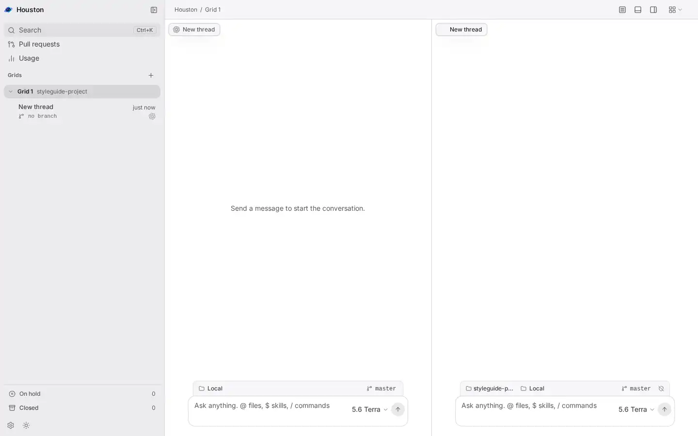
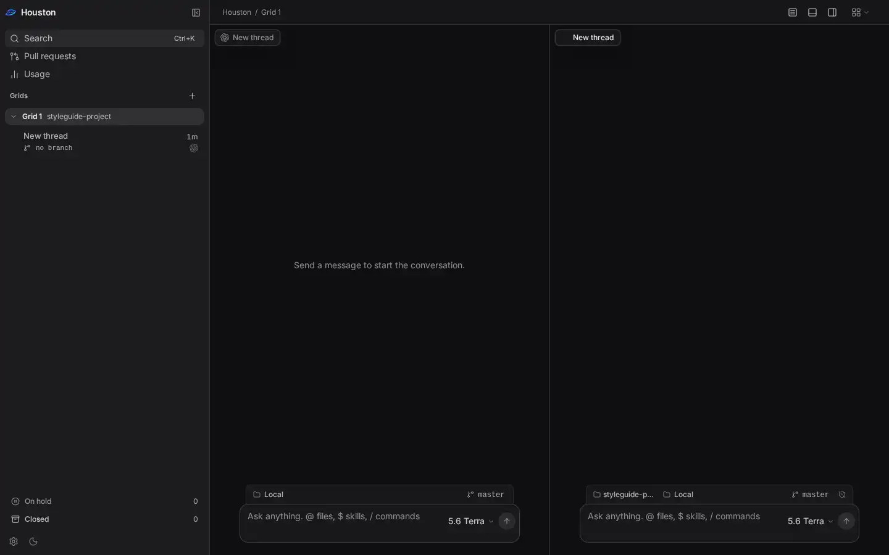

- **Shell.** `AppSidebarLayout` composes `SidebarProvider` with a left `Sidebar` and the
  route content. The thread sidebar is resizable between 240px and 440px, defaults to
  340px, and collapses off-canvas. Its rows are `--h-row` on `--sidebar` (the rail).
- **Top bar.** 40px (`--h-top`, `--workspace-topbar-height`), a drag region with no native
  title bar. Controls opt out with `no-drag`. On the desktop host the three window controls
  occupy `--w-window-control` each at the right end.
- **Thread route.** A thread fills the content area flush: no card radius, no gutter, no
  pane header when it is the only thread. The chat lane is 760px
  (`--chat-content-max-width`), while the timeline narrows to 720px; the thread-details
  card is 340px (`--thread-details-panel-width`). The composer sits at the bottom of the
  lane.
- **Grid.** Cells are divided by 1px `--divider`. A grid with two or more threads has no
  pane header; each cell carries a floating label at `top-2 left-2`: provider mark,
  truncated title, status glyph, and the pane actions on hover. The label is a 26px
  (`--h-pill`), 7px (`--r-selection`) pill on `--pane-head` with a 1px `--divider` border.
  A single thread has no label.
- **Right panel.** Docked to the right edge, flush and divided by `--divider`. It opens on
  an "Open a surface" launcher and gains tiled surfaces (Files, Diff, Browser, Terminal,
  Pull request) through the launcher or the "Add panel surface" menu. Its top row holds the
  panel controls, and the window controls return to the main top bar when it closes.
- **Bottom terminal.** The `ThreadTerminalDrawer` is a bottom sheet over the thread and is
  dismissed without closing the agent session.
- **Settings.** `/settings/<section>` is a full-window route with its own left navigation
  and a 720px (`--settings-w`) content column. The page header is the 40px top bar; each page
  opens with its title and a one-line description from `SettingsPageContainer`, then the scope line.
- **Content pages.** `WorkspacePageContainer` owns the column: `readable` is 896px
  (`max-w-4xl`), `wide` is 1040px, and `expanded` is 1152px (`max-w-6xl`). There is no
  `--page-w` token; `page-width` rejects a per-page pixel width.

### Phone

A browser narrower than 40rem (`--breakpoint-phone` in `index.css`) is a phone; tablets keep
the docked layout. `apps/web/src/mobile/usePhone.ts` mirrors the token as
`PHONE_QUERY = "(width < 40rem)"` and exposes `useIsPhone`; the `phone:` and `max-phone:`
Tailwind variants gate CSS at the same width. A phone replaces the desktop chrome with its own
home page, thread bar and bottom tab bar.

- **`apps/web/src/mobile/` adapts, never forks.** It reuses `GridSidebar`, `ChatView`,
  `ChatComposer`, `RightPanelTabs`, `ThreadDetailsCard` and the composer's pickers. It owns
  only what has no desktop counterpart: the phone shell and tab bar, the thread bar, and the
  bottom sheets for model, attachments, details and files or changes.
- **Phone behaviour is gated.** Gate it with `useIsPhone()`, a phone prop or the
  `max-phone:`/`phone:` variants, so the layout at 40rem and wider is unchanged. A component
  that a desktop test mounts directly takes an explicit prop (such as `phone`, `sheet` or
  `isPage`) instead of reading the query.
- **Hit areas are 44px.** Touch primitives expand through `pointer-coarse`; phone-only rows,
  tabs and bar controls use `h-11` (44px). A smaller visible box is acceptable only when its
  hit target reaches the same floor.
- **Sheets share one recipe.** A phone bottom sheet is `SheetPopup variant="phone"` with
  `PhoneSheetHeader` (a 44px bar, title at the 16px inset, a 44px close centred on it), the
  scrim, rounded top corners and the bottom inset on the popup. Rows inside are 44px, full
  width, with content on the 16px gutter; `phone-page` is the same popup as a full-window page.
- **Safe areas are applied once.** `#root` owns the top inset. A phone page applies `pb-safe`
  around its content, the tab bar or a sheet owns the bottom inset in its own surface, and a
  composer inside the page drops its own safe-area term so the inset is not counted twice.

### Stacking

The app's layer order, as the primitives use it:

| Layer                 | Value             | What sits there                                     |
| --------------------- | ----------------- | --------------------------------------------------- |
| Terminal drawer       | 45                | The bottom terminal over the timeline.              |
| Sheet                 | `--z-sheet` (46)  | Docked sheets.                                      |
| Dialog                | 50                | Dialogs and their scrim.                            |
| Media dialog          | 60                | A media dialog opened from inside another overlay.  |
| Window                | `--z-window` (70) | Frameless window chrome. `--z-window-resize` is 69. |
| Toast                 | 100               | Transient status banners.                           |
| Menu, select, popover | 130               | Anchored floating surfaces.                         |
| Tooltip               | 140               | Hover labels.                                       |

**Known drift.** The layer comment in `index.css` stops at the dialog range and does not list
the menu (130), tooltip (140) or theme editor (110/120) layers. The table above is the ladder
the primitives actually use.

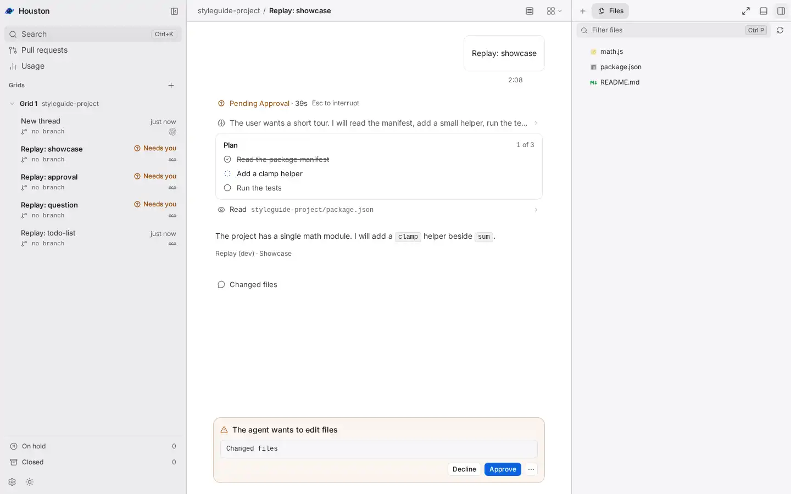
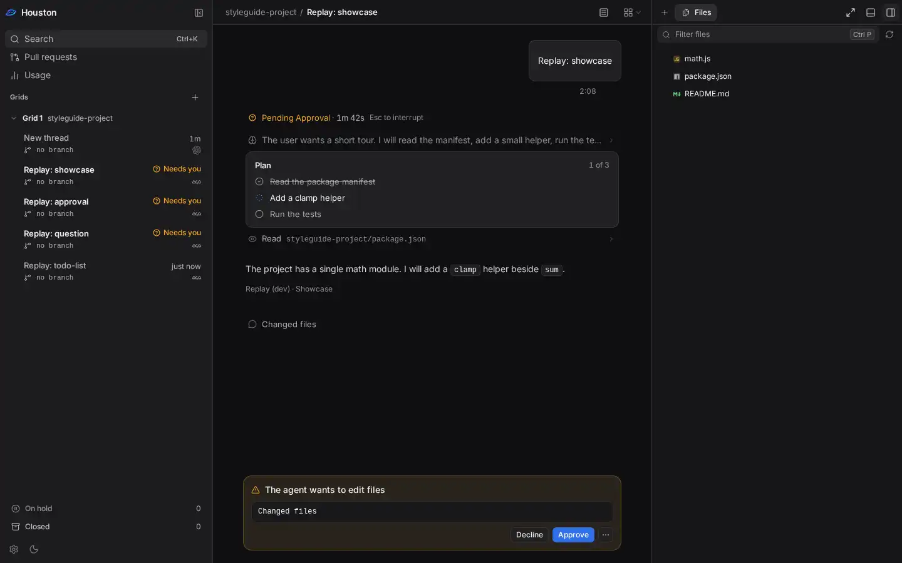

## Components

Compose from `apps/web/src/components/ui/`. Add a variant to a primitive instead of writing a
new visual recipe in a feature file. The `ui-boundary` rule scans feature class strings; its
baseline records copied feature components until a slice adapts them.

| Primitive                          | Use                                                                                                                                                                                                                                                                              |
| ---------------------------------- | -------------------------------------------------------------------------------------------------------------------------------------------------------------------------------------------------------------------------------------------------------------------------------- |
| `Button`                           | Every action. Variants: `default` (primary fill), `primary` (brand fill), `destructive`, `destructive-outline`, `outline`, `secondary`, `ghost`, `ghost-muted`, `ghost-destructive`, `link`, `glass`, `raised`, `overlay`, `warning-outline`, `media-close`, `media-navigation`. |
| `InlineButton`                     | A link-shaped action inside prose or a row; tones `default`, `muted`, `destructive`, `picker`.                                                                                                                                                                                   |
| `Input`, `Textarea`, `Label`       | Form controls. `Input` sizes `compact`, `default`, `lg`; `Textarea` sizes `sm`, `default`, `lg`.                                                                                                                                                                                 |
| `Select`                           | Every dropdown. Native `<select>` is rejected by the `native-select` rule. Size `compact`, `default`, `sm`, `xs`; variants `default` and `ghost`.                                                                                                                                |
| `Menu`                             | Context menus, submenus, checkbox and radio menu items, and searchable menus.                                                                                                                                                                                                    |
| `Popover`                          | Anchored rich content. `variant` is `default`, `panel` or `dialog`; `width` is `auto`, `sm`, `md` or `lg`.                                                                                                                                                                       |
| `Dialog`, `Sheet`                  | Modal dialogs and edge sheets. Dialog variants are `default` and `media`; sheets take a side.                                                                                                                                                                                    |
| `Tooltip`                          | Every hover label. Native `title=` is rejected by `title-tooltip`.                                                                                                                                                                                                               |
| `Toggle`, `ToggleGroup`            | Pressed toggles and segmented groups. `ToggleGroup` defaults to the `segmented` variant over `--field`.                                                                                                                                                                          |
| `Switch`, `Checkbox`, `RadioGroup` | Form state. Native checkbox/radio inputs are rejected by `native-input`.                                                                                                                                                                                                         |
| `Badge`                            | Counts and status words. Variants: `default`, `outline`, `secondary`, `info`, `success`, `warning`, `destructive`, `error`, `label`; sizes `control`, `default`, `sm`.                                                                                                           |
| `Table`                            | Tabular content: `TableHeader`, `TableBody`, `TableRow`, `TableHead`, `TableCell`.                                                                                                                                                                                               |
| `Empty`                            | Empty states: `EmptyHeader`, `EmptyMedia`, `EmptyTitle`, `EmptyDescription`, `EmptyContent`; sizes `compact`, `default`, `welcome`.                                                                                                                                              |
| `Alert`                            | Inline information: variants `default`, `sidebar`, `error`, `info`, `success`, `warning`, `stateError`, `stateWarning`; surface `default` or `glass`.                                                                                                                            |
| `Toast`                            | Transient results. Toasts stack at layer 100 and use the same status variants.                                                                                                                                                                                                   |
| `Kbd`                              | Key hints; `KbdGroup` joins a sequence.                                                                                                                                                                                                                                          |
| `Skeleton`, `Spinner`              | Loading states. Both animate only when motion is allowed.                                                                                                                                                                                                                        |
| `ScrollArea`                       | The clipped scroll surface with the shared scrollbar and fade treatment.                                                                                                                                                                                                         |
| `ThreadStateGlyph`                 | The one thread-status vocabulary: `running`, `ready`, `needs`, `failed`, `back`.                                                                                                                                                                                                 |
| `CopyButton`                       | Copy with the shared copied-state feedback.                                                                                                                                                                                                                                      |

The thread state tokens are the readable ones:
`running` → `text-(--accent-ink)`, `ready` → `text-success-foreground`, `needs` →
`text-(--warn-ink)`, `failed` → `text-error-foreground`, `back` →
`text-secondary-foreground`. The glyph shapes differ as well, so colour is never the only
signal.

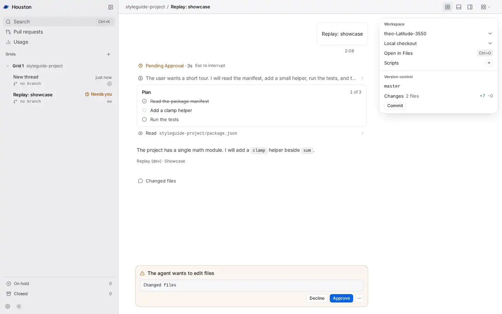
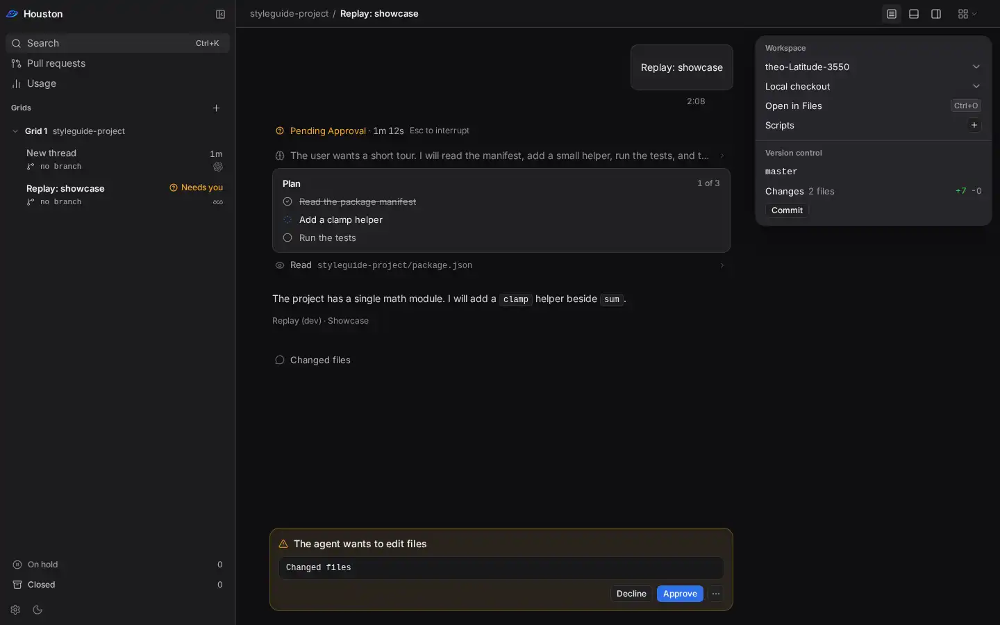
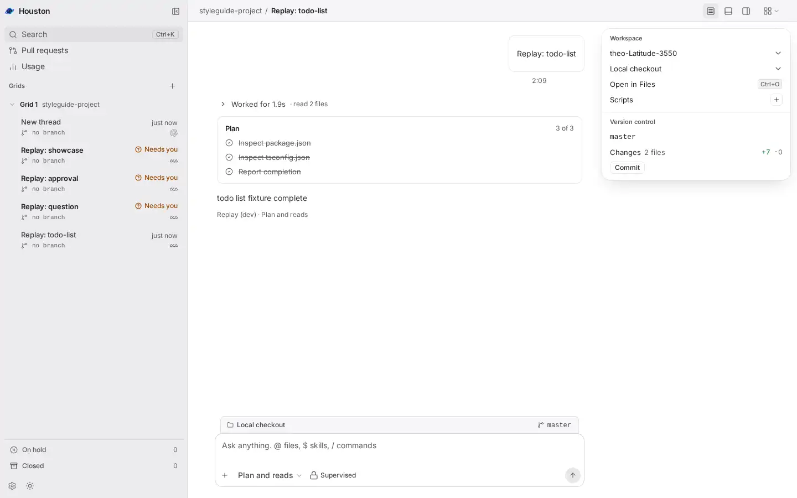
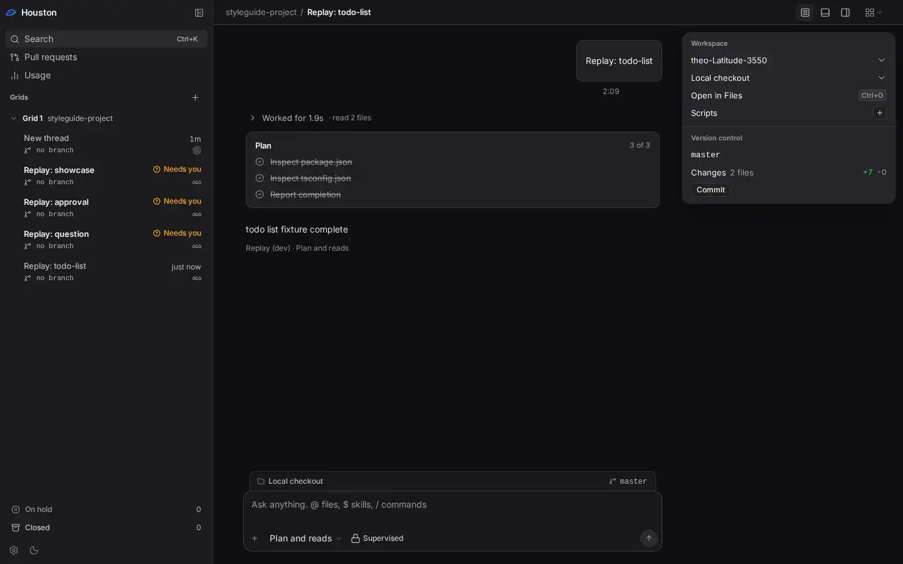

## Patterns

### Empty states

Use `Empty` with an icon (`EmptyMedia variant="icon"`), a title, one sentence and at most one
action. The `empty-state-action` rule requires the control when the copy names an action;
a statement of fact ("No results.") is enough when there is nothing to do.

### Status

Use `ThreadStateGlyph` anywhere a thread's state is shown: sidebar rows, grid labels, the
right panel and the timeline. Use the word alongside the glyph when the row does not already
identify the state. Keep the status words separate from chrome copy.

### Settings

Settings pages are sections of the same full-window shell. A setting is a row with a title,
a description and one control; switches are for booleans, `Select` for short enumerated
choices, and `Input` for free values. Keep one primary action per page, and name a limit,
its current value and the requested operation in the error.

### Thread composer

The composer is the primary surface: one card holding the input and its toolbar. The context
row (project, environment, branch, permissions) sits below the card as borderless muted text,
and the changed-files bar attaches to the card's top edge. The controls inside keep their own
focus rings, and the footer ends in one primary action whose icon
names what Enter does. The timeline is 14/20 prose in a 720px lane with a 0.75rem block gap.

### Pull requests and usage

Destination pages use `WorkspacePageContainer` and the 40px page header. Pull requests uses
the `expanded` column and usage the `wide` one; their tables and charts use the status tokens
above rather than the Tailwind palette.

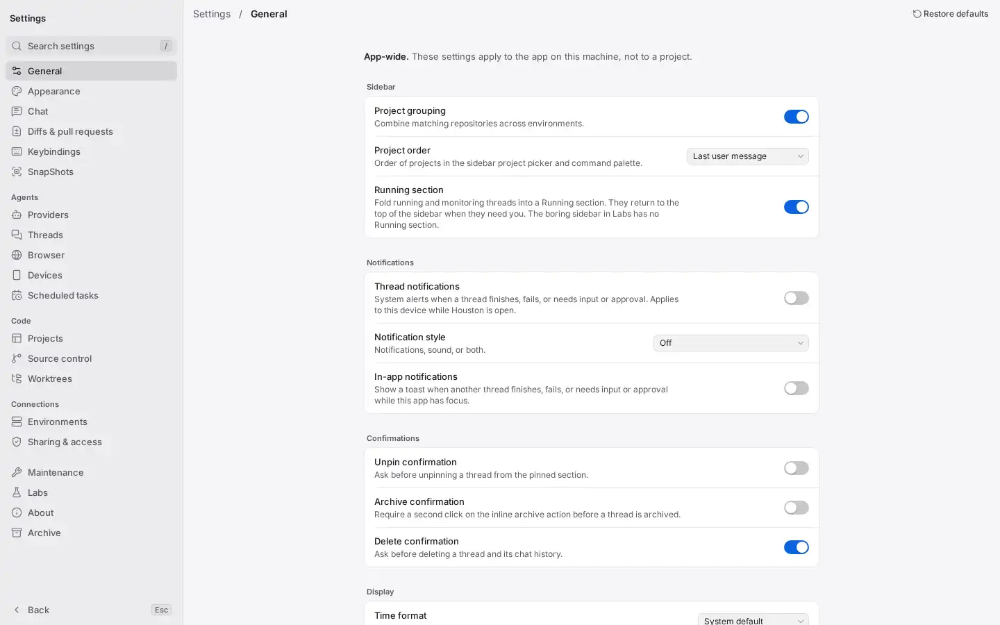
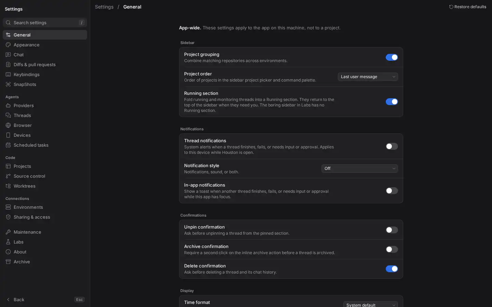
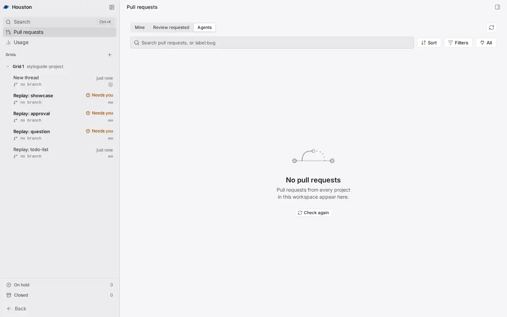
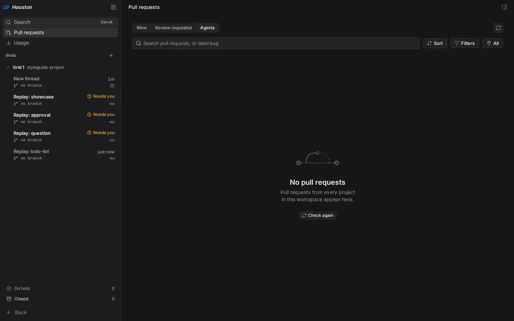

## Voice and copy

- Sentence case for buttons, headings, field labels, menu items and tooltips. The `copy`
  rule rejects title case in `title`, `label` and `aria-label` props, with an allowlist for
  product and provider names.
- Counts sit beside a label without parentheses or a middle dot; the `copy` rule rejects
  `(N)` and `· N` in those props.
- Use the ellipsis character (`…`), never three ASCII dots; `ellipsis` rejects the ASCII
  form in source strings and JSX text.
- Uppercase labels use `uppercase` plus a tracking utility; `label-tracking` rejects
  `tracking-wide`, `tracking-wider` and `tracking-widest` outside uppercase text.
- A limit error names the limit, its actual value and the requested operation. An error
  includes the offending value and the expected shape.

## States

| State    | Treatment                                                                                                                                                        |
| -------- | ---------------------------------------------------------------------------------------------------------------------------------------------------------------- |
| Focus    | `focus-visible:outline-2 focus-visible:outline-ring` on the interactive primitive, with the app's `outline-offset: -2px` so the ring stays inside clipped edges. |
| Hover    | The neutral `bg-hover` fill; icon buttons also raise their ink to `text-foreground`.                                                                             |
| Selected | `bg-selected` (`--sel`) for rows and tiles. Selection is achromatic.                                                                                             |
| Pressed  | `data-pressed` shares the hover fill; segmented controls and toggles keep the pressed segment on `--shadow-seg`.                                                 |
| Disabled | `Button` uses `opacity-[0.45]`; `Input`, `Select`, `Badge`, `Switch` and `Checkbox` use `opacity-64`. Disabled controls still carry a reason when one exists.    |
| Invalid  | `aria-invalid` paints a destructive border; do not hand-paint a red border.                                                                                      |
| Loading  | `Skeleton` for placeholders and `Spinner` for a known wait; both hold a settled frame under reduced motion.                                                      |
| Running  | `ThreadStateGlyph state="running"` pulses only while the run is genuinely indeterminate.                                                                         |

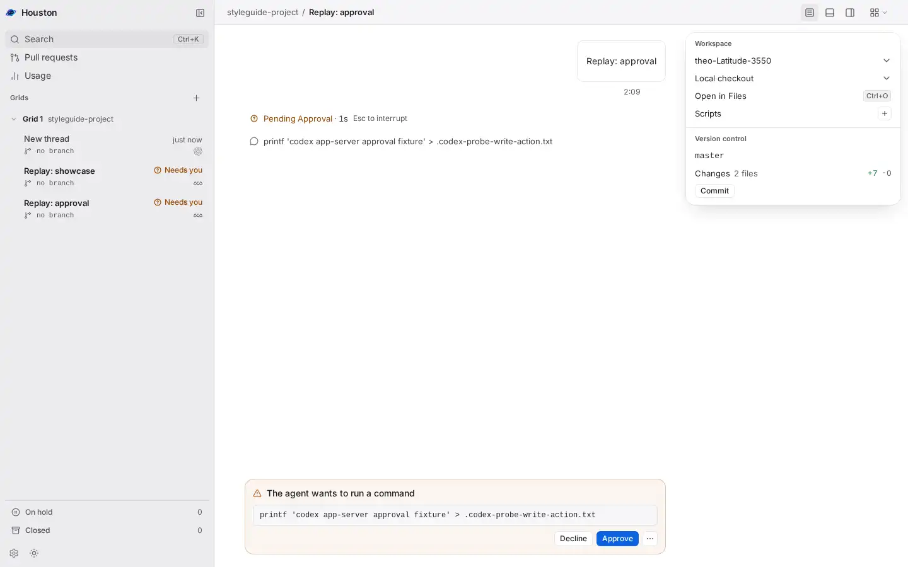
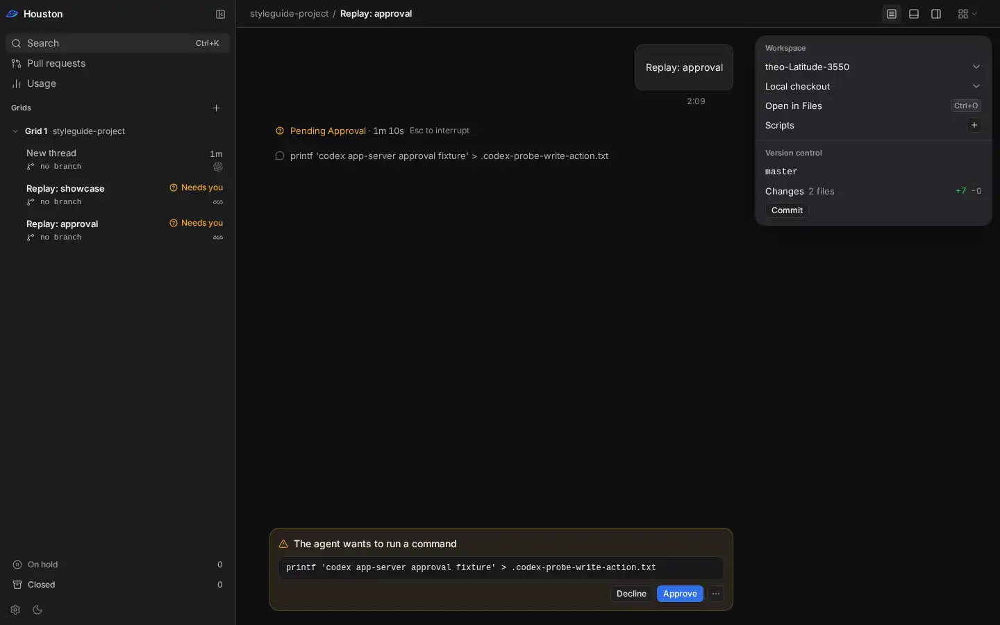
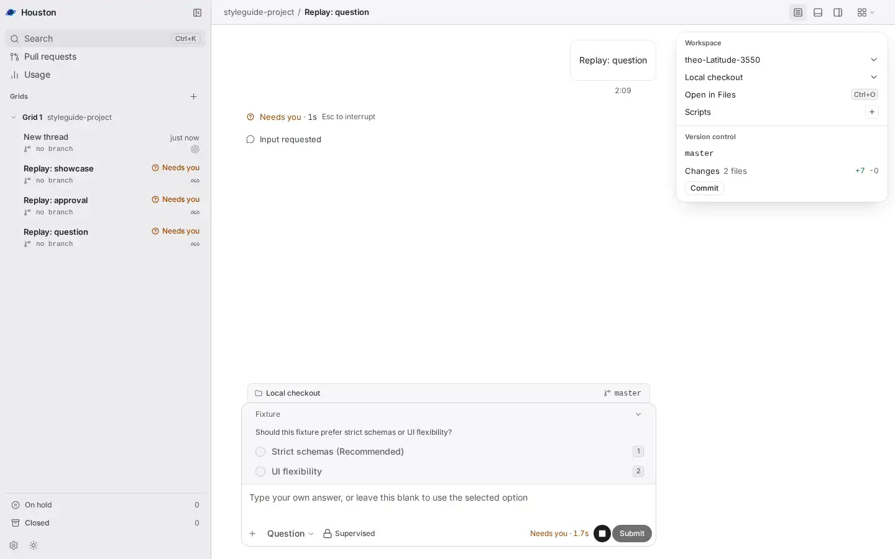
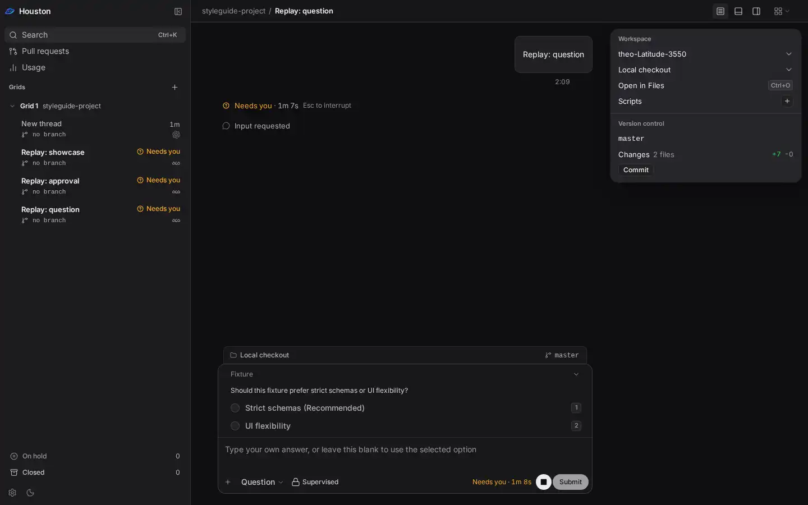

## Motion

- Named easing: `--ease-drawer` (`cubic-bezier(0.32, 0.72, 0, 1)`) for surfaces that slide
  or pop in. Everything else uses Tailwind's `duration-*` and `ease-*` utilities at 120–200ms.
- Named animations: `--animate-skeleton`, `--animate-status-pulse`, `--animate-status-ping`,
  the stash-pulse set, `live-tool-shine` and `live-activity-focus`.
- Animate transform and opacity. The status pulse and skeleton step their opacity so the
  compositor draws discrete frames instead of one update per vsync.
- `Spinner` runs through `visible-animate-spin`, which pauses while hidden.
- Reduced motion is the system preference or the Appearance **Animations** switch, which sets
  `data-motion="off"` on the root. CSS gates motion with the `motion-safe`/`motion-reduce`
  variants that `index.css` redefines for both; script reads `prefersReducedMotion` or
  `useReducedMotion`. A registry test rejects any other `prefers-reduced-motion` read; a
  shadow-root sheet pairs its media query with `:host-context([data-motion="off"])`. Loading
  and status indicators keep their settled, visible state.
- A theme switch uses a View Transition reveal from the clicked control
  (`data-theme-reveal`); without a click, without View Transition support, or under reduced
  motion it is instant.
- No general-purpose animation library. Motion is CSS transitions plus the View Transition
  API for the theme reveal.

## Accessibility

- Every icon-only control carries an `aria-label`, usually with a `Tooltip`. Native
  `title=` does not count as a label; the `title-tooltip` rule rejects it.
- Real roles come from Base UI: `menu`/`menuitem`, `dialog`, `combobox`/`listbox`/`option`,
  and `switch`/`checkbox`/`radio`.
- `native-select` and `native-input` keep native dropdowns and checkbox/radio controls out
  of the renderer. Use `Select`, `Checkbox`, `RadioGroup` or `Switch`.
- Focus is always visible: primitives paint a `focus-visible` ring, and `focus-visible`
  rejects `outline-none` without a replacement paint.
- Do not rely on colour alone. Status glyphs differ in shape, destructive actions carry an
  icon, and an invalid field carries `aria-invalid`.
- `pointer-coarse` expands small controls to a 44px hit area.
- `text-primary` and `text-(--accent)` are fills; use `text-(--accent-ink)` for readable
  brand text. The `accent-ink` rule enforces it.

## Terminal palettes

Terminal colour is a separate axis from chrome. `ThreadTerminalDrawer.tsx` owns the 16-entry
ANSI arrays for the light and dark appearances, and `terminalThemeFromApp` reads the chrome
tokens around the mounted terminal:

- `--terminal-background`
- `--terminal-foreground`
- `--terminal-cursor`
- `--terminal-selection-background`

Those tokens are declared in `index.css` and can be overridden by a theme. The terminal
surface is `--term` (its own ground, not `--content`). Command output rendered in chat uses
the palettes in `packages/shared/src/terminalOutput.ts`, so an ANSI-styled line matches the
terminal without importing chrome CSS.

The ANSI palette is fixed per appearance; it is not a user-selectable preset list in v2.
Never assume the terminal background equals a chrome token: the terminal is free to be the
darkest surface while the surrounding pane is a card.

## Guards

`scripts/check-web-style.mjs` scans `apps/web/src` against the rules below and pins current
violations in `scripts/web-style-baseline/`. A change may lower a pin, never raise one.

```sh
bash scripts/check-web-style.sh              # every rule against its baseline
bash scripts/check-web-style.sh --all        # print every failure
bash scripts/check-web-style.sh --list       # list the rules
bash scripts/check-web-style.sh --print copy # print hits for one rule
bash scripts/check-web-style.sh --update copy # lower one pin to today's count
bash scripts/check-web-style.sh --self-test  # prove each rule fires on its fixtures
```

| Rule                 | Policy                                                                                                  |
| -------------------- | ------------------------------------------------------------------------------------------------------- |
| `native-select`      | Use `Select`, never a native `<select>`.                                                                |
| `native-input`       | Use `Checkbox`, `RadioGroup` or `Switch`, never a native checkbox/radio.                                |
| `ellipsis`           | The `…` character, never three ASCII dots.                                                              |
| `title-tooltip`      | `Tooltip`, never a native `title=` hover label.                                                         |
| `focus-visible`      | `outline-none` must pair with a visible focus paint; no interpolated arbitrary values.                  |
| `radius`             | Role radii (`--r-*`), never numeric arbitrary radii or CSS radius literals.                             |
| `shadow`             | Token shadows or complete literal recipes, never a hand-typed shadow.                                   |
| `type-scale`         | `--text-*` steps, never a literal font size.                                                            |
| `spacing`            | Tailwind spacing, never a hand-typed length.                                                            |
| `control-metrics`    | `h-(--h-ctl)`, `h-(--h-row)`, `h-(--h-pane-head)` or `h-(--h-pill)`, never a hand-typed control height. |
| `icon-metrics`       | Icon size and stroke from the class or a shared role, never numeric props.                              |
| `icon-imports`       | Named `lucide-react` imports; namespaces only in `lib/lucideIconByName.ts`.                             |
| `copy`               | Sentence case, counts without parentheses or a middle dot, approved status words.                       |
| `ui-boundary`        | Layout utilities only outside `components/ui`; visual recipes belong in primitives.                     |
| `page-width`         | `WorkspacePageContainer` widths, never a per-page pixel column.                                         |
| `raw-palette`        | Semantic status roles, never raw Tailwind palette shades in components.                                 |
| `accent-utility`     | `bg-hover` / `text-hover-foreground`, never `bg-accent` / `text-accent-foreground`.                     |
| `accent-ink`         | `text-(--accent-ink)` for brand text, never `text-primary` or `text-(--accent)`.                        |
| `label-tracking`     | Tracking only on uppercase label text.                                                                  |
| `empty-state-action` | An empty state that names an action must offer the control, or state a fact.                            |

Baselines are per file, not per total: moving a violation between files still needs
`--update`. `--update` records what the scanner finds, so fix a false positive in the scanner
and its fixture rather than pinning it.

Complementary checks: `scripts/check-upstream.mjs` byte-compares vendored `apps/web` files
against `upstream.json`; `knip` owns module-level reachability (it exempts unused exports
under `components/ui/*.tsx`, because `cva` variants are selected dynamically); and
`bash scripts/check-comment-hygiene.sh` keeps comments free of session history.

## When this is silent

1. Reach for a primitive in `components/ui/`; add a variant there rather than a visual class
   in a feature file.
2. Copy a sibling for behaviour, not for chrome.
3. Use the role token (`--r-ctl`, `--t2`, `--divider`) rather than the value.
4. When two patterns contradict, prefer the tested one, then the more recent one, and flag
   the other.
